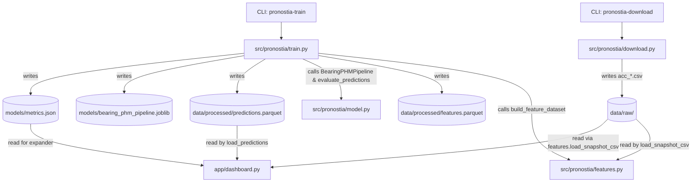

# PRONOSTIA Bearing Monitor — Project & Code Explanation

This document explains the purpose of every file in the `pronostia-bearing-monitor` repository, what each class and function does, how functions relate to one another, and where each one is used across the project.

---

## 1. End-to-End Architecture & Data Flow

The project implements an end-to-end Prognostics & Health Management (PHM) pipeline for the **PRONOSTIA (IEEE PHM 2012)** bearing vibration dataset:

1. **Data Acquisition (`src/pronostia/download.py`)** — Clones the real dataset from GitHub or generates a physics-based synthetic dataset under `data/raw/`.
2. **Feature Engineering (`src/pronostia/features.py`)** — Reads raw 25.6 kHz accelerometer CSV snapshots and extracts time-domain, frequency-domain (Welch PSD), Hilbert envelope, and rolling trend features.
3. **Modeling & Alerting (`src/pronostia/model.py`)** — Trains an unsupervised Health Indicator (PCA + Isolation Forest) and a supervised Remaining Useful Life (RUL) regressor (`HistGradientBoostingRegressor`), and runs a hysteresis-based alert state machine (`HEALTHY` → `WARNING` → `CRITICAL`).
4. **Training Orchestration (`src/pronostia/train.py`)** — Runs feature extraction, enforces a strict bearing-level train/test split, fits the model, scores all bearings, evaluates metrics, and saves artifacts to `data/processed/` and `models/`.
5. **Interactive Visualization (`app/dashboard.py`)** — Loads saved predictions, metrics, and raw CSV snapshots to render an interactive Streamlit + Plotly monitoring dashboard.



---

## 2. Project Configuration & Root Files

### `pyproject.toml`
- **Role**: Python package metadata, dependency specification, build configuration (`hatchling`), and CLI script registration.
- **Key Connections**:
  - Registers two CLI entry points that invoke the package's `main()` functions:
    - `pronostia-download` → `pronostia.download:main`
    - `pronostia-train` → `pronostia.train:main`
  - Packages `src/pronostia` as the `pronostia` importable module.
  - Declares core dependencies: `numpy`, `pandas`, `scipy`, `scikit-learn`, `joblib`, `pyarrow`, `streamlit`, `plotly`.

### `uv.lock`
- **Role**: Auto-generated dependency lockfile managed by `uv` to ensure reproducible installs via `uv sync`.

### `README.md`
- **Role**: High-level project overview, capabilities summary, quick-start commands, and directory layout guide.

### `.gitignore`
- **Role**: Excludes virtual environments (`.venv/`, `venv/`), Python bytecode/build artifacts (`__pycache__/`, `dist/`, `build/`), tool caches, `.env` files, and OS metadata files from Git tracking.

---

## 3. Source Package (`src/pronostia/`)

### `src/pronostia/__init__.py`
- **Role**: Marks `src/pronostia` as a Python package and exposes `__version__ = "0.1.0"`.
- **Functions**: None.

---

### `src/pronostia/download.py`
- **Role**: Acquires raw PRONOSTIA accelerometer snapshot CSV files (`acc_*.csv`), either by cloning the real IEEE PHM 2012 dataset from GitHub or by synthesizing realistic vibration data locally for fast testing.
- **Module Constants**:
  - `REPO_URL`: GitHub URL of the IEEE PHM 2012 dataset.
  - `OPERATING_CONDITIONS`: Maps condition IDs (`1`, `2`, `3`) to `rpm`, `load_n`, and `shaft_hz`. Used by `generate_synthetic_pronostia()`.
  - `DEFAULT_SYNTHETIC_BEARINGS`: Defines the synthetic `Learning_set` (6 bearings) and `Full_Test_Set` (3 bearings) with their condition ID, number of snapshots, and RNG seed. Used by `generate_synthetic_pronostia()`.

#### Functions in `src/pronostia/download.py`

1. **`download_pronostia(output_dir: Path, learning_only: bool = False) -> None`**
   - **What it does**: Creates `output_dir` and checks if `Learning_set` already exists (skipping download if so). Verifies `git` is installed via `shutil.which("git")`, then runs `git clone --depth 1` on `REPO_URL`. If `learning_only=True`, it uses a blobless sparse checkout (`--filter=blob:none --sparse` + `sparse-checkout set Learning_set`) to download only `Learning_set`.
   - **Calls**: `shutil.which`, `subprocess.run`.
   - **Used where**: Called by `main()` in `src/pronostia/download.py` when `--synthetic` is **not** passed.

2. **`_simulate_snapshot(t: np.ndarray, progress: float, shaft_hz: float, rng: np.random.Generator) -> tuple[np.ndarray, np.ndarray]`**
   - **What it does**: Internal helper that synthesizes one 0.1-second (2,560 samples at 25.6 kHz) dual-axis (horizontal, vertical) vibration snapshot at normalized lifecycle progress `progress ∈ [0, 1]`.
     - Generates a healthy baseline (shaft fundamental + 2× harmonic + Gaussian sensor noise).
     - Models exponential degradation after an onset threshold (`0.58`).
     - Adds outer-race fault impulses (`bpfo = 3.58 * shaft_hz`) modulating a 3.2 kHz structural resonance.
     - Injects random high-frequency micro-spalling shocks once degradation exceeds `0.25`.
   - **Calls**: NumPy signal/random math only.
   - **Used where**: Called inside the snapshot loop of `generate_synthetic_pronostia()` in `src/pronostia/download.py`.

3. **`generate_synthetic_pronostia(output_dir: Path, samples_per_snapshot: int = 2560) -> None`**
   - **What it does**: Iterates through `DEFAULT_SYNTHETIC_BEARINGS` (`Learning_set` and `Full_Test_Set`), creates each bearing folder, and generates `n_files` snapshots spaced 10 seconds apart. Formats each snapshot into the exact 6-column PRONOSTIA CSV schema (`hour, minute, second, microsecond, horiz_accel, vert_accel` with no header) and saves it as `acc_00001.csv`, `acc_00002.csv`, etc.
   - **Calls**: `_simulate_snapshot()`.
   - **Used where**: Called by `main()` in `src/pronostia/download.py` when `--synthetic` is passed.

4. **`main() -> None`**
   - **What it does**: CLI entry point parsing `--output-dir` (default `data/raw`), `--synthetic`, and `--learning-only`. Dispatches to either `generate_synthetic_pronostia()` or `download_pronostia()`.
   - **Calls**: `generate_synthetic_pronostia()` or `download_pronostia()`.
   - **Used where**:
     - Registered as the `pronostia-download` console script in `pyproject.toml`.
     - Invoked directly when running `python -m pronostia.download` (`if __name__ == "__main__":`).

#### Internal Relationships (`download.py`)
```
main()
 ├── [--synthetic]     ──▶ generate_synthetic_pronostia() ──▶ _simulate_snapshot()
 └── [default]         ──▶ download_pronostia()
```

---

### `src/pronostia/features.py`
- **Role**: Performs raw CSV ingestion and signal-processing feature extraction for 25.6 kHz vibration snapshots across all bearings.
- **Module Constants**:
  - `FS_HZ = 25600.0`: Sampling frequency (25.6 kHz). Imported and reused by `app/dashboard.py`.
  - `SNAPSHOT_INTERVAL_SEC = 10.0`: Time between consecutive snapshots (10 seconds).
  - `OPERATING_CONDITIONS`: Maps condition ID (`1`, `2`, `3`) to `rpm` and `load_n`.
  - `FREQ_BANDS`: Four frequency bands up to Nyquist (12.8 kHz): `0–2 kHz`, `2–5 kHz`, `5–9 kHz`, `9–12.8 kHz`.

#### Functions in `src/pronostia/features.py`

1. **`load_snapshot_csv(csv_path: Path) -> tuple[np.ndarray, np.ndarray]`**
   - **What it does**: Inspects the first line of a PRONOSTIA `acc_*.csv` file to auto-detect whether the delimiter is `;` (seen in bearings like `Bearing1_4`) or `,`. Loads columns 4 and 5 (horizontal and vertical acceleration) as `float64` NumPy arrays.
   - **Calls**: `np.loadtxt`.
   - **Used where**:
     - Called by `extract_bearing_features()` in `src/pronostia/features.py` for every snapshot CSV.
     - Imported and called by `app/dashboard.py` to plot the raw vibration waveform and Welch PSD for the currently selected snapshot.

2. **`extract_axis_features(x: np.ndarray, prefix: str, fs: float = FS_HZ) -> dict[str, float]`**
   - **What it does**: Zero-means a 1D vibration array `x` and computes 18 features prefixed with `prefix` (`"h"` or `"v"`):
     - **Time-domain (9)**: `rms`, `peak`, `p2p`, `crest`, `impulse`, `shape`, `kurtosis`, `skew`, `energy`.
     - **Frequency-domain via Welch PSD (7)**: `spec_centroid`, `spec_entropy`, `dom_freq`, plus 4 band power ratios (`band_0_2k_ratio`, `band_2_5k_ratio`, `band_5_9k_ratio`, `band_9_12k_ratio`).
     - **Hilbert envelope (2)**: `env_rms`, `env_kurtosis` (sensitive to periodic bearing raceway impacts).
   - **Calls**: `scipy.signal.welch`, `scipy.signal.hilbert`, `scipy.stats.kurtosis`, `scipy.stats.skew`.
   - **Used where**: Called twice per snapshot (for horizontal `"h"` and vertical `"v"`) inside `extract_bearing_features()`.

3. **`parse_bearing_condition(bearing_name: str) -> int`**
   - **What it does**: Uses regex `r"Bearing(\d+)_"` to extract the operating condition integer (`1`, `2`, or `3`) from folder names like `Bearing1_3` (defaults to `1` if unmatched).
   - **Calls**: `re.search`.
   - **Used where**: Called by `extract_bearing_features()` to look up `rpm` and `load_n` in `OPERATING_CONDITIONS`.

4. **`extract_bearing_features(bearing_dir: Path, split_name: str) -> pd.DataFrame`**
   - **What it does**: Processes a single bearing's run-to-failure folder:
     1. Lists and sorts all `acc_*.csv` files.
     2. Determines operating condition (`rpm`, `load_n`).
     3. For each snapshot, loads `(horiz, vert)` via `load_snapshot_csv()`, computes metadata/targets (`elapsed_min`, `rul_min`, `rul_pct`), and calls `extract_axis_features()` for both axes.
     4. Adds temporal trend features for 6 key signals (`h_rms`, `v_rms`, `h_kurtosis`, `v_kurtosis`, `h_env_rms`, `v_env_rms`):
        - `*_ewma`: Exponentially weighted moving average (`span=10`) to smooth spikes.
        - `*_slope`: 5-step difference of the EWMA.
        - `*_rel`: Ratio relative to the median of the bearing's first 10% healthy run-in snapshots.
   - **Calls**: `parse_bearing_condition()`, `load_snapshot_csv()`, `extract_axis_features()`.
   - **Used where**: Called by `build_feature_dataset()` in `src/pronostia/features.py` for each discovered bearing folder.

5. **`discover_bearing_dirs(raw_dir: Path) -> list[tuple[str, Path]]`**
   - **What it does**: Scans `Learning_set`, `Full_Test_Set`, and `Test_set` subdirectories under `raw_dir` and returns `(split_name, bearing_path)` pairs for every subdirectory containing `acc_*.csv` files.
   - **Calls**: `Path.iterdir`, `Path.glob`.
   - **Used where**: Called by `build_feature_dataset()` in `src/pronostia/features.py`.

6. **`build_feature_dataset(raw_dir: Path) -> pd.DataFrame`**
   - **What it does**: Top-level feature extraction pipeline. Discovers all bearing folders, extracts features for each one, and concatenates them into a single unified DataFrame.
   - **Calls**: `discover_bearing_dirs()`, `extract_bearing_features()`.
   - **Used where**: Imported and called by `main()` in `src/pronostia/train.py`.

#### Internal Relationships (`features.py`)
```
build_feature_dataset()
 ├── discover_bearing_dirs()
 └── extract_bearing_features()
      ├── parse_bearing_condition()
      ├── load_snapshot_csv()        [also imported by app/dashboard.py]
      └── extract_axis_features()    [called for 'h' and 'v' axes]
```

---

### `src/pronostia/model.py`
- **Role**: Defines the core PHM modeling pipeline (unsupervised Health Indicator, supervised RUL predictor, and persistence-based alert state machine) and evaluation metrics.
- **Module Constants**:
  - `METADATA_COLS`: Non-feature columns excluded from RUL model input (`split`, `bearing`, `file_name`, `snapshot_idx`, `elapsed_min`, `rul_min`, `rul_pct`).
  - `HI_DRIVER_COLS`: The 10 key degradation features (`h_rms_rel`, `v_rms_rel`, `h_rms_ewma`, `v_rms_ewma`, `h_kurtosis_ewma`, `v_kurtosis_ewma`, `h_env_rms_ewma`, `v_env_rms_ewma`, `h_peak`, `v_peak`) used to compute the Health Indicator.

#### Classes & Functions in `src/pronostia/model.py`

1. **`AlertConfig` (dataclass)**
   - **What it does**: Configuration container for alert thresholds and persistence hysteresis:
     - `warning_hi = 0.35`, `critical_hi = 0.70`
     - `warning_rul_pct = 0.30`, `critical_rul_pct = 0.12`
     - `persistence = 3` (consecutive snapshots required before latching a state transition)
   - **Used where**: Defaulted inside `BearingPHMPipeline.__init__()` and read inside `BearingPHMPipeline.predict_bearing()`.

2. **`BearingPHMPipeline` (class)**
   Encapsulates the dual-output PHM model and alert engine.
   - **`__init__(self, alert_config: AlertConfig | None = None) -> None`**
     - Initializes `AlertConfig`, `RobustScaler`, `PCA(n_components=3)`, `IsolationForest(n_estimators=150, contamination=0.05)`, and a `sklearn.pipeline.Pipeline` (`StandardScaler` + `HistGradientBoostingRegressor`) for RUL prediction.
     - **Used where**: Instantiated in `src/pronostia/train.py:main()`.
   - **`_select_feature_cols(self, df: pd.DataFrame) -> list[str]`**
     - Returns all DataFrame columns not in `METADATA_COLS`.
     - **Used where**: Called by `fit()`.
   - **`_raw_health_score(self, df: pd.DataFrame) -> np.ndarray`**
     - Scales `self.hi_cols` with `hi_scaler`, projects into 3D PCA space (`hi_pca`), computes Euclidean distance from the healthy origin (`pca_dist`), and combines it with the negated `IsolationForest.score_samples` anomaly score: `0.65 * pca_dist + 0.35 * iso_anom`.
     - **Used where**: Called by `fit()` (for percentile calibration) and `predict_bearing()` (for inference).
   - **`fit(self, train_df: pd.DataFrame) -> BearingPHMPipeline`**
     - Selects `feature_cols` and `hi_cols`.
     - Fits `hi_scaler`, `hi_pca`, and `iso_forest` exclusively on the healthy run-in portion (`rul_pct >= 0.80`) of the training bearings.
     - Computes `hi_p05` (5th percentile) and `hi_p95` (97th percentile) of `_raw_health_score(train_df)` to normalize future HI values into `[0, 1]`.
     - Trains `rul_model` on all engineered features to predict `rul_pct`.
     - Computes and stores `median_life_by_cond` (median total runtime in minutes per operating condition) for converting `pred_rul_pct` into minutes.
     - **Calls**: `_select_feature_cols()`, `_raw_health_score()`.
     - **Used where**: Called by `src/pronostia/train.py:main()`.
   - **`predict_bearing(self, bearing_df: pd.DataFrame) -> pd.DataFrame`**
     - Scores a single bearing's chronologically sorted trajectory:
       1. **Health Index**: Computes `_raw_health_score()`, min-max normalizes using `[hi_p05, hi_p95]`, clips to `[0, 1]` (`health_index_raw`), and applies EWMA smoothing (`span=8`) to produce `health_index`.
       2. **RUL Prediction**: Runs `rul_model.predict()`, clips to `[0, 1]`, smooths with EWMA (`span=6`) to produce `pred_rul_pct`, then estimates total life by blending elapsed time with `median_life_by_cond` (capped at `2.5 × nominal_life`) to compute `pred_rul_min`.
       3. **Alert State Machine**: Steps through `(health_index, pred_rul_pct)` maintaining consecutive breach counters (`warn_streak`, `crit_streak`). Once a threshold is breached for `cfg.persistence` consecutive snapshots, latches `alert_state` monotonically (`HEALTHY` → `WARNING` → `CRITICAL`) and sets boolean `failure_flag`.
     - **Calls**: `_raw_health_score()`.
     - **Used where**: Called by `predict()` for each `(split, bearing)` group.
   - **`predict(self, df: pd.DataFrame) -> pd.DataFrame`**
     - Groups a multi-bearing DataFrame by `["split", "bearing"]`, calls `predict_bearing()` on each group, and concatenates the scored results.
     - **Calls**: `predict_bearing()`.
     - **Used where**: Called by `src/pronostia/train.py:main()`.

3. **`evaluate_predictions(pred_df: pd.DataFrame) -> dict[str, Any]`**
   - **What it does**: Computes overall regression metrics (`rul_pct_mae`, `rul_pct_rmse`, `rul_min_mae`) and per-bearing summary statistics (`total_life_min`, `rul_pct_mae`, `warning_lead_min`, `critical_lead_min` — how many minutes before failure the first `WARNING` and `CRITICAL` flags fired).
   - **Calls**: `sklearn.metrics.mean_absolute_error`, `sklearn.metrics.root_mean_squared_error`.
   - **Used where**: Imported and called by `src/pronostia/train.py:main()`, whose output is saved to `models/metrics.json` and later displayed in `app/dashboard.py`.

#### Internal Relationships (`model.py`)
```
BearingPHMPipeline
 ├── __init__() ─────────▶ AlertConfig
 ├── fit() ──────────────▶ _select_feature_cols(), _raw_health_score()
 └── predict() ──────────▶ predict_bearing() ──▶ _raw_health_score()

evaluate_predictions()   [standalone function consuming output of predict()]
```

---

### `src/pronostia/train.py`
- **Role**: End-to-end CLI script that orchestrates feature extraction, bearing-level train/test splitting, model training, inference, evaluation, and artifact persistence.

#### Functions in `src/pronostia/train.py`

1. **`main() -> None`**
   - **What it does**:
     1. Parses CLI arguments: `--raw-dir` (`data/raw`), `--processed-dir` (`data/processed`), `--models-dir` (`models`).
     2. Calls `build_feature_dataset(args.raw_dir)` and saves `data/processed/features.parquet`.
     3. Splits data strictly at the bearing level (preventing snapshot leakage): `Learning_set` for training, all other splits for testing. If only `Learning_set` exists, falls back to holding out `Bearing*_2` as the test set.
     4. Instantiates `BearingPHMPipeline()`, calls `.fit(train_df)`, and scores all bearings with `.predict(features_df)`.
     5. Saves scored predictions to `data/processed/predictions.parquet`.
     6. Filters test bearings, calls `evaluate_predictions(test_preds)`, and saves the trained pipeline (`models/bearing_phm_pipeline.joblib`) and evaluation report (`models/metrics.json`).
   - **Calls**:
     - `pronostia.features.build_feature_dataset()`
     - `pronostia.model.BearingPHMPipeline` (`.fit()`, `.predict()`)
     - `pronostia.model.evaluate_predictions()`
     - `joblib.dump()`
   - **Used where**:
     - Registered as the `pronostia-train` console script in `pyproject.toml`.
     - Invoked directly when running `python -m pronostia.train` (`if __name__ == "__main__":`).

---

## 4. Interactive Dashboard (`app/dashboard.py`)

- **Role**: Streamlit + Plotly web application for replaying bearing degradation trajectories, inspecting real-time alert states, viewing live raw vibration waveforms and FFT spectra, and reviewing test-set evaluation metrics.
- **Imports from `pronostia`**:
  - `FS_HZ` and `load_snapshot_csv` from `src/pronostia/features.py` (used to read and analyze the raw `acc_*.csv` file for the currently selected snapshot).
- **Module Constants**:
  - `PROJECT_ROOT`, `PREDICTIONS_PATH` (`data/processed/predictions.parquet`), `METRICS_PATH` (`models/metrics.json`), `RAW_DIR` (`data/raw`).
  - `STATUS_COLORS`: Maps `HEALTHY` (green), `WARNING` (amber), and `CRITICAL` (red) to hex colors.

#### Functions & Script Sections in `app/dashboard.py`

1. **`load_predictions() -> pd.DataFrame`** (decorated with `@st.cache_data`)
   - **What it does**: Cached loader that reads `data/processed/predictions.parquet` into a pandas DataFrame (returning an empty DataFrame if the file does not yet exist).
   - **Used where**: Called at top level of `app/dashboard.py` on page load/rerun.

2. **Top-Level Streamlit UI Flow** (executed sequentially on each Streamlit rerun):
   - **Sidebar Controls**: Lets the user pick `Dataset Split`, `Bearing Asset`, scrub `Current Snapshot` via a slider, or click **▶ Simulate Live Stream from Start** to animate snapshots in a loop.
   - **Top KPI Row**: Displays the latched `ALERT STATUS` badge, `Health Index (Degradation)` with 5-snapshot delta, `Predicted RUL` (minutes & %), `Horiz. Vibration RMS` + kurtosis, and `Operating Condition` (RPM & load).
   - **Trajectory Subplots (Plotly)**:
     - Top chart: `health_index` (%) over time with dashed `WARNING (35%)` and `CRITICAL (70%)` lines and diamond markers on the first trigger of each state.
     - Bottom chart: `pred_rul_pct` (%) vs. ground-truth `rul_pct` (%).
   - **Live Sensor Diagnostics**: Locates `data/raw/<split>/<bearing>/<file_name>`, calls `load_snapshot_csv()` from `pronostia.features`, computes Welch PSD (`scipy.signal.welch` with `FS_HZ`), and plots both the 0.1s raw horizontal/vertical waveform and the Power Spectral Density (dB vs. kHz).
   - **Test Set Evaluation Metrics**: If `models/metrics.json` exists, renders its JSON contents inside an expandable section.

---

## 5. Cross-Reference Summary

### Function & Class Usage Map

| Symbol | Defined In | Calls | Used Where |
| :--- | :--- | :--- | :--- |
| `download_pronostia()` | `src/pronostia/download.py` | `shutil.which`, `subprocess.run` | `download.py:main()` |
| `_simulate_snapshot()` | `src/pronostia/download.py` | NumPy math/RNG | `download.py:generate_synthetic_pronostia()` |
| `generate_synthetic_pronostia()` | `src/pronostia/download.py` | `_simulate_snapshot()` | `download.py:main()` |
| `main()` | `src/pronostia/download.py` | `generate_synthetic_pronostia()`, `download_pronostia()` | CLI `pronostia-download` (`pyproject.toml`) |
| `load_snapshot_csv()` | `src/pronostia/features.py` | `np.loadtxt` | `features.py:extract_bearing_features()`, `app/dashboard.py` |
| `extract_axis_features()` | `src/pronostia/features.py` | `signal.welch`, `signal.hilbert`, `stats.kurtosis`, `stats.skew` | `features.py:extract_bearing_features()` |
| `parse_bearing_condition()` | `src/pronostia/features.py` | `re.search` | `features.py:extract_bearing_features()` |
| `extract_bearing_features()` | `src/pronostia/features.py` | `parse_bearing_condition()`, `load_snapshot_csv()`, `extract_axis_features()` | `features.py:build_feature_dataset()` |
| `discover_bearing_dirs()` | `src/pronostia/features.py` | `Path.iterdir`, `Path.glob` | `features.py:build_feature_dataset()` |
| `build_feature_dataset()` | `src/pronostia/features.py` | `discover_bearing_dirs()`, `extract_bearing_features()` | `train.py:main()` |
| `AlertConfig` | `src/pronostia/model.py` | — | `BearingPHMPipeline.__init__()`, `BearingPHMPipeline.predict_bearing()` |
| `BearingPHMPipeline._select_feature_cols()` | `src/pronostia/model.py` | — | `BearingPHMPipeline.fit()` |
| `BearingPHMPipeline._raw_health_score()` | `src/pronostia/model.py` | `hi_scaler`, `hi_pca`, `iso_forest` | `BearingPHMPipeline.fit()`, `BearingPHMPipeline.predict_bearing()` |
| `BearingPHMPipeline.fit()` | `src/pronostia/model.py` | `_select_feature_cols()`, `_raw_health_score()`, `rul_model.fit()` | `train.py:main()` |
| `BearingPHMPipeline.predict_bearing()` | `src/pronostia/model.py` | `_raw_health_score()`, `rul_model.predict()` | `BearingPHMPipeline.predict()` |
| `BearingPHMPipeline.predict()` | `src/pronostia/model.py` | `predict_bearing()` | `train.py:main()` |
| `evaluate_predictions()` | `src/pronostia/model.py` | `mean_absolute_error`, `root_mean_squared_error` | `train.py:main()` |
| `main()` | `src/pronostia/train.py` | `build_feature_dataset()`, `BearingPHMPipeline`, `evaluate_predictions()`, `joblib.dump()` | CLI `pronostia-train` (`pyproject.toml`) |
| `load_predictions()` | `app/dashboard.py` | `pd.read_parquet` | `app/dashboard.py` (top-level Streamlit app) |

### Generated Data & Model Artifacts

| Artifact Path | Written By | Read By |
| :--- | :--- | :--- |
| `data/raw/<split>/<bearing>/acc_*.csv` | `src/pronostia/download.py` | `src/pronostia/features.py`, `app/dashboard.py` |
| `data/processed/features.parquet` | `src/pronostia/train.py` | Saved intermediate feature dataset |
| `data/processed/predictions.parquet` | `src/pronostia/train.py` | `app/dashboard.py` (`load_predictions()`) |
| `models/bearing_phm_pipeline.joblib` | `src/pronostia/train.py` | Saved serialized `BearingPHMPipeline` model |
| `models/metrics.json` | `src/pronostia/train.py` | `app/dashboard.py` (Metrics expander) |
